[Español](README.md) | [English](README_EN.md)

# Telco Customer Churn — Databricks

**End-to-End Data Engineering · Machine Learning · MLOps**

       

Proyecto académico de análisis y predicción del abandono de clientes de telecomunicaciones, desde la ingestión de datos hasta una aplicación interactiva de inferencia.


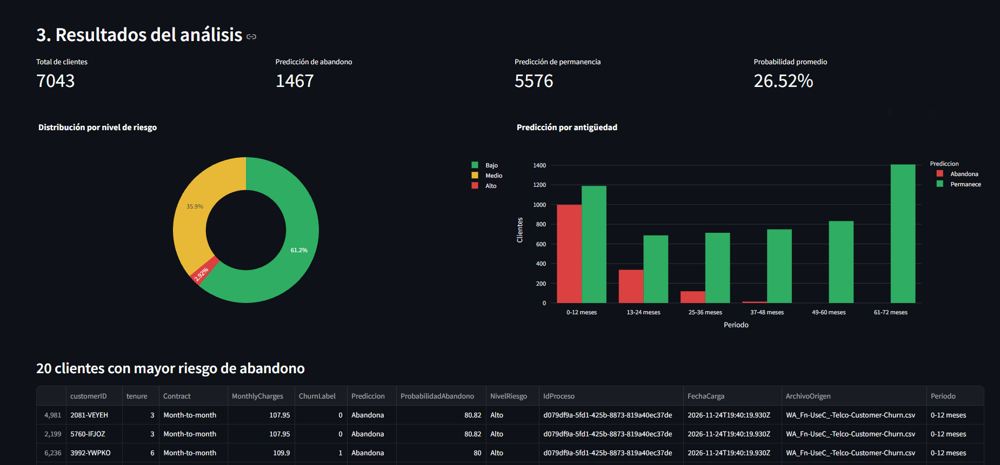


## Contenido

- [Descripción y objetivos](#descripción-y-objetivos)
- [Arquitectura](#arquitectura)
- [Datos](#datos)
- [Ingeniería de datos](#ingeniería-de-datos)
- [Machine Learning](#machine-learning)
- [Evaluación](#evaluación)
- [Registro del modelo](#registro-del-modelo)
- [Automatización](#automatización)
- [Dashboard y aplicación](#dashboard-y-aplicación)
- [Resultados](#resultados)
- [Estructura del repositorio](#estructura-del-repositorio)
- [Implementación](#implementación)
- [Limitaciones y mejoras](#limitaciones-y-mejoras)
- [Referencias](#referencias)

## Descripción y objetivos

El abandono de clientes reduce los ingresos recurrentes. El objetivo es identificar clientes con mayor probabilidad de abandonar, facilitar la priorización de acciones de retención y construir un flujo reproducible de datos y predicciones. No se mide el impacto económico de las intervenciones.

## Arquitectura

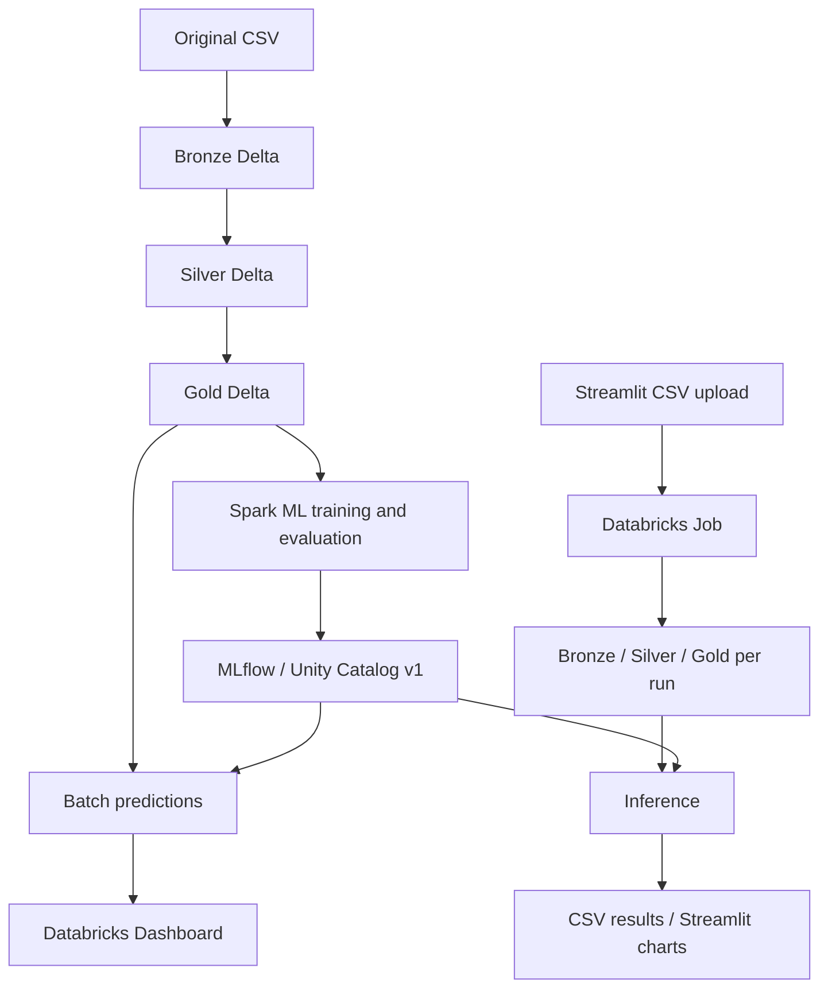

Tecnologías: Python, PySpark, Spark ML, Delta Lake, SQL, Databricks Jobs, Unity Catalog, MLflow, Streamlit, pandas y Plotly.

## Datos

El conjunto original Telco Customer Churn contiene 7,043 registros y 21 columnas. La variable objetivo es `Churn` (Yes/No). Para inferencia, la aplicación requiere cuatro columnas; `customerID` identifica el registro y las otras tres alimentan el modelo. `Churn` es opcional para inferencia.

| Variable | Tipo | Descripción |
|---|---|---|
| customerID | string | Identificador |
| tenure | integer | Antigüedad en meses |
| MonthlyCharges | double | Cargo mensual |
| Contract | string | Month-to-month / One year / Two year |

Consulta [data/](data/) para los ejemplos, datos sintéticos y documentación de variables. Los datos sintéticos sirven para pruebas funcionales, no para validar rendimiento real.

## Ingeniería de datos

- **Bronze:** ingestión del CSV en Delta Lake.
- **Silver:** conversión de `TotalCharges`, tratamiento de 11 valores faltantes asociados a antigüedad cero, deduplicación por `customerID` y creación de `ChurnLabel` (0/1).
- **Gold:** datos preparados para análisis, entrenamiento e indicadores.

`workspace.default`: `bronze_telco`, `silver_telco`, `gold_telco`, `gold_antiguedad`, `gold_contratos`, `gold_indicadores`, `gold_predicciones`.

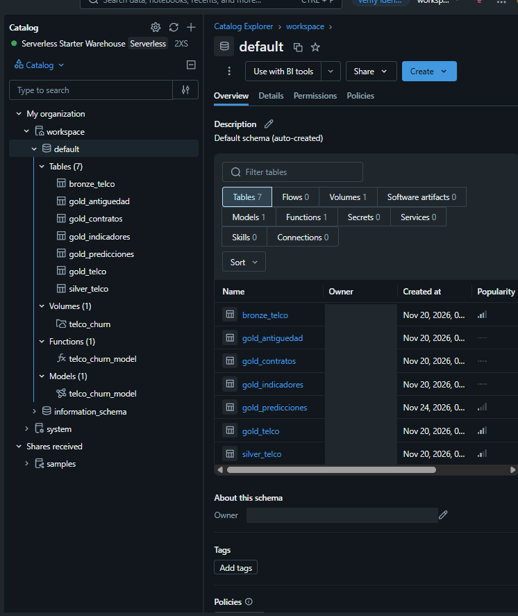


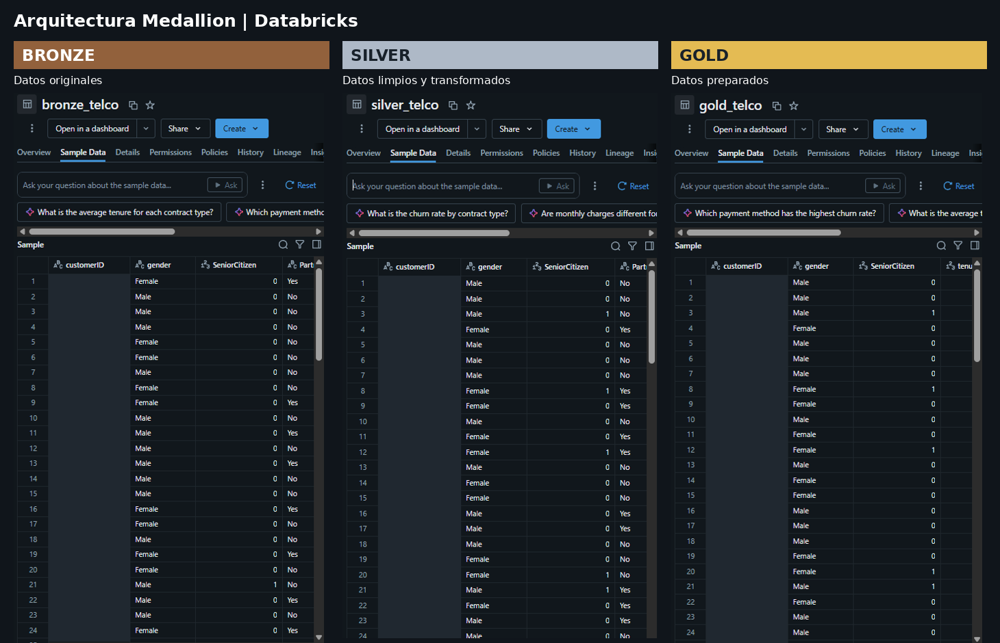


## Machine Learning

Se utiliza regresión logística binaria de Spark ML. La división aleatoria es 80/20 con semilla 42. El pipeline transforma `Contract` con StringIndexer y OneHotEncoder, combina las variables mediante VectorAssembler y ajusta LogisticRegression.

`Contract → StringIndexer → OneHotEncoder → VectorAssembler (+ tenure, MonthlyCharges) → LogisticRegression`

## Evaluación

Conjunto de prueba: 1,409 registros.

| Métrica | Valor |
|---|---:|
| Accuracy | 78.42% |
| F1 (ponderado) | 77.41% |
| AUC-ROC | 0.8217 |
| Precision (churn) | 62.59% |
| Recall (churn) | 47.61% |
| F1 (churn) | 54.08% |

| Real / Predicción | Permanece | Abandona |
|---|---:|---:|
| 0 | 926 | 107 |
| 1 | 197 | 179 |

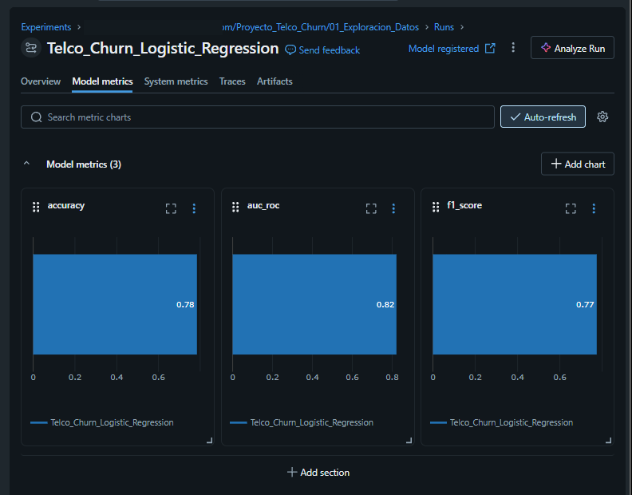


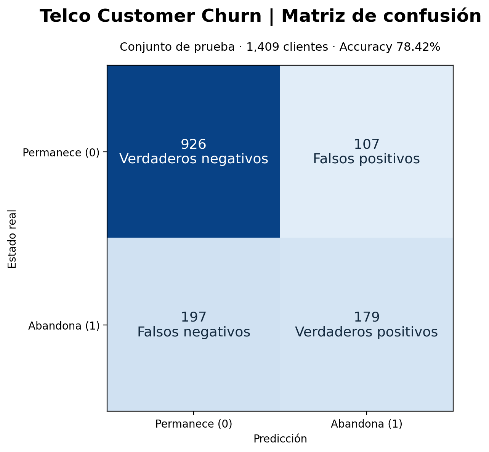

El modelo detecta 179 de 376 abandonos reales. Los 197 falsos negativos son una limitación relevante. Las métricas de MLflow se registraron como valores explícitos en el notebook; conviene automatizar su registro desde los evaluadores.

## Registro del modelo

Modelo registrado en Unity Catalog mediante MLflow, versión 1, con firma de tres variables. Se utiliza inferencia por lotes, no un endpoint de Model Serving.

`models:/workspace.default.telco_churn_model/1`

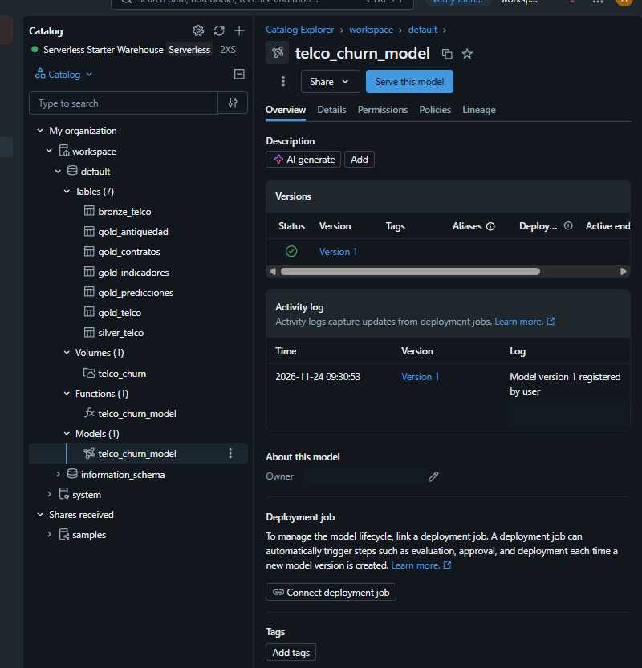


## Automatización

| Job | Notebook | Compute |
|---|---|---|
| Pipeline_Telco_Churn | 01_Exploracion_Datos | Serverless |
| Pipeline_Telco_App | 02_Procesar_Nuevos_Clientes | Serverless |

El segundo Job recibe `archivo_csv` e `id_proceso`. Streamlit inicia el Job y consulta su estado. Los resultados se separan por identificador de ejecución. Se observaron seis ejecuciones exitosas del Job de la aplicación, entre 68 y 154 segundos, incluyendo cola; esto no constituye una prueba de carga.

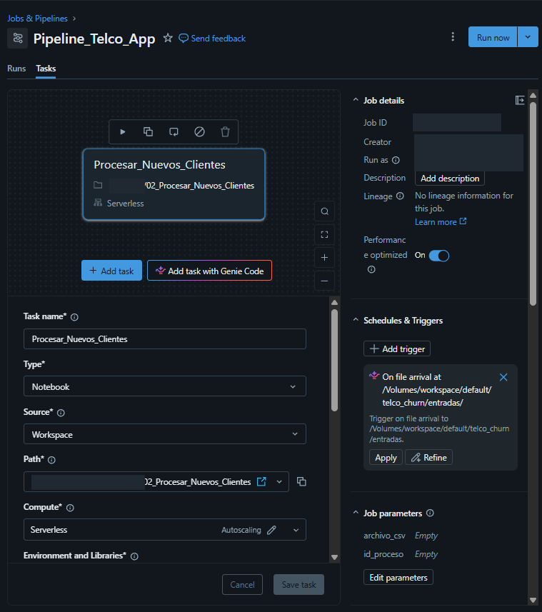


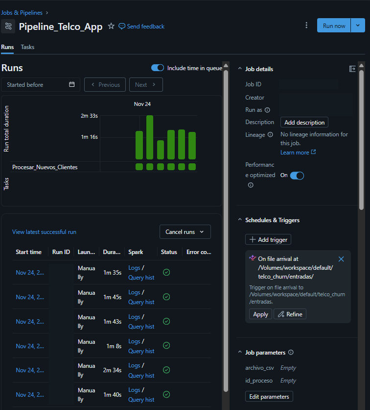


## Dashboard y aplicación

El dashboard presenta indicadores, distribución de riesgo, antigüedad y clientes prioritarios. Streamlit permite cargar CSV o elegir la base original, ejecutar el pipeline, consultar gráficos y descargar predicciones.

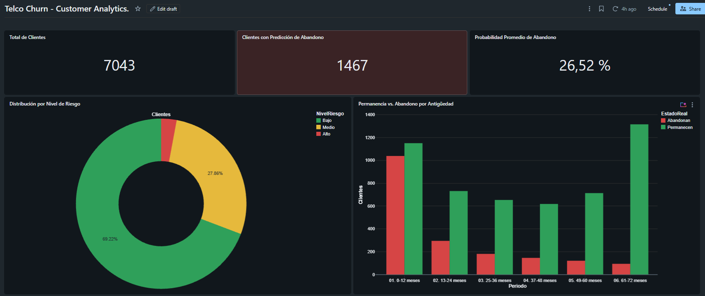


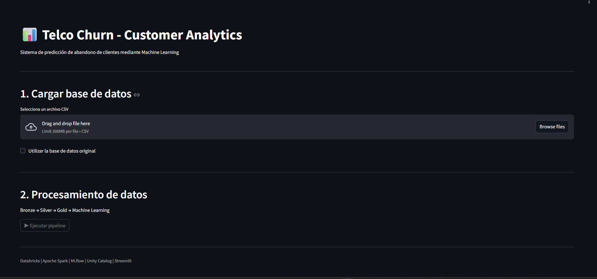


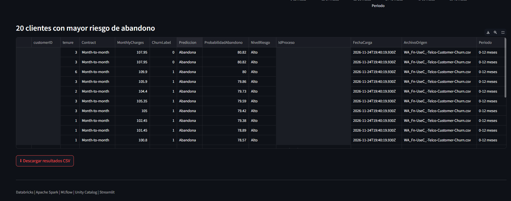


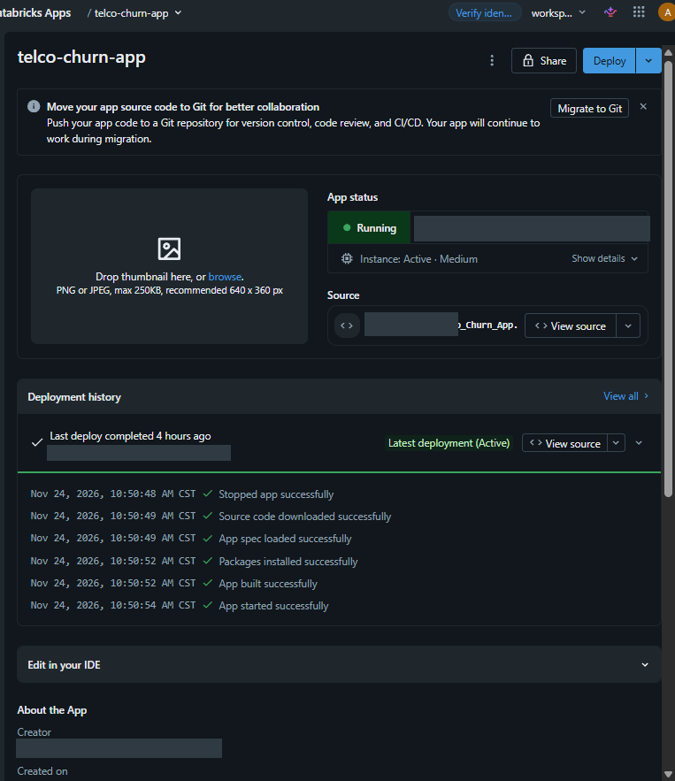


## Resultados

| Indicador | Resultado |
|---|---:|
| Clientes | 7,043 |
| Abandono predicho | 1,467 |
| Permanencia predicha | 5,576 |
| Probabilidad media | 26.52% |
| Abandono real | 1,869 |

Estos resultados corresponden al conjunto completo, no a una evaluación independiente. Consulta [results/](results/).

## Estructura del repositorio

```text
.
├── app/
├── data/
├── docs/
├── images/
├── notebooks/
├── results/
├── scripts/
├── tests/
├── README.md
└── README_EN.md
```

Los directorios `scripts` y `tests` documentan trabajo previsto; no implican una suite automatizada ejecutada.

## Implementación

1. Clona el repositorio e importa los notebooks en Databricks.
2. Crea o adapta el catálogo, esquema y volumen `telco_churn`; carga el CSV original obtenido de su fuente autorizada.
3. Revisa las rutas y permisos del notebook y ejecuta `01_Exploracion_Datos` para crear tablas y registrar el modelo.
4. Configura los dos Jobs serverless; en el segundo define `archivo_csv` e `id_proceso`.
5. Crea una Databricks App con los archivos de `app/`, configura los recursos `telco-job` y `volume` y sus permisos. `TELCO_JOB_ID` se obtiene del recurso Job; revisa también la ruta de volumen fija en el código.
6. Despliega y prueba con un CSV de ejemplo; comprueba los resultados y la descarga.

Se requiere acceso a Databricks con Spark ML, Unity Catalog, Jobs y Apps habilitados. No se incluyen credenciales.

## Limitaciones y mejoras

- Mejorar recall y evaluar umbrales, balance de clases y modelos alternativos.
- Unificar niveles de riesgo: actualmente el dashboard y la aplicación utilizan límites distintos para riesgo bajo/medio (40% y 30% respectivamente). El gráfico por antigüedad del dashboard muestra estado real y el de Streamlit predicciones.
- Incorporar validación automatizada, dependencias versionadas y monitoreo de drift.
- La aplicación carga datos en memoria con pandas y muestra un límite de carga de 200 MB; no se ha demostrado escalabilidad a millones de registros.
- No se ha validado el impacto de acciones de retención ni el rendimiento sobre clientes futuros.

## Referencias

- [IBM Telco Customer Churn (Kaggle)](https://www.kaggle.com/datasets/blastchar/telco-customer-churn)
- [Databricks](https://docs.databricks.com/)
- [Apache Spark ML](https://spark.apache.org/docs/latest/ml-guide.html)
- [MLflow](https://mlflow.org/docs/latest/)
- [Streamlit](https://docs.streamlit.io/)

Proyecto académico y de portafolio.
