[Español](README.md) | [English](README_EN.md)

# Telco Customer Churn — Databricks

**End-to-End Data Engineering · Machine Learning · MLOps**

       

Academic telecommunications customer churn project, from data ingestion to an interactive inference application.


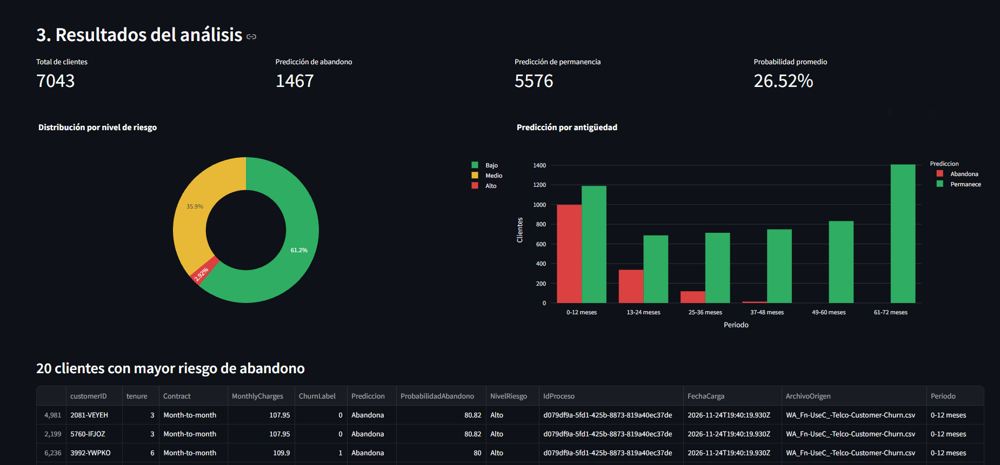


## Contents

- [Overview and objectives](#overview-and-objectives)
- [Architecture](#architecture)
- [Data](#data)
- [Data engineering](#data-engineering)
- [Machine learning](#machine-learning)
- [Evaluation](#evaluation)
- [Model registry](#model-registry)
- [Automation](#automation)
- [Dashboard and application](#dashboard-and-application)
- [Results](#results)
- [Repository structure](#repository-structure)
- [Implementation](#implementation)
- [Limitations and improvements](#limitations-and-improvements)
- [References](#references)

## Overview and objectives

Customer churn reduces recurring revenue. The goal is to identify customers more likely to leave, support retention prioritization and build a reproducible data and prediction workflow. The financial impact of interventions is not measured.

## Architecture

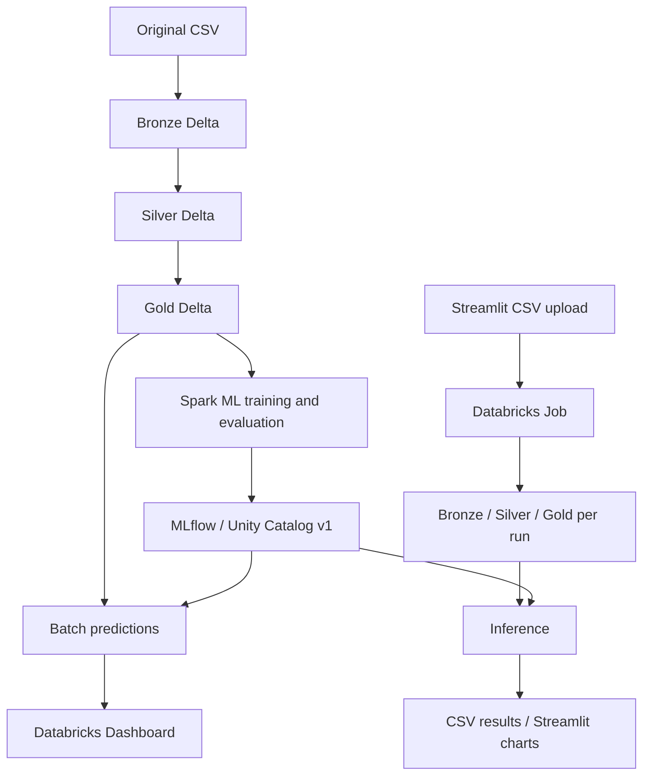

Technologies: Python, PySpark, Spark ML, Delta Lake, SQL, Databricks Jobs, Unity Catalog, MLflow, Streamlit, pandas and Plotly.

## Data

The original Telco Customer Churn dataset contains 7,043 records and 21 columns. The target is `Churn` (Yes/No). For inference, the app requires four columns; `customerID` identifies the record and the other three feed the model. `Churn` is optional for inference.

| Variable | Type | Description |
|---|---|---|
| customerID | string | Identifier |
| tenure | integer | Tenure in months |
| MonthlyCharges | double | Monthly charge |
| Contract | string | Month-to-month / One year / Two year |

See [data/](data/) for examples, synthetic data and variable documentation. Synthetic data supports functional testing, not real-world performance validation.

## Data engineering

- **Bronze:** CSV ingestion into Delta Lake.
- **Silver:** `TotalCharges` conversion, handling of 11 missing values associated with zero tenure, deduplication by `customerID`, and creation of `ChurnLabel` (0/1).
- **Gold:** data prepared for analytics, training and indicators.

`workspace.default`: `bronze_telco`, `silver_telco`, `gold_telco`, `gold_antiguedad`, `gold_contratos`, `gold_indicadores`, `gold_predicciones`.

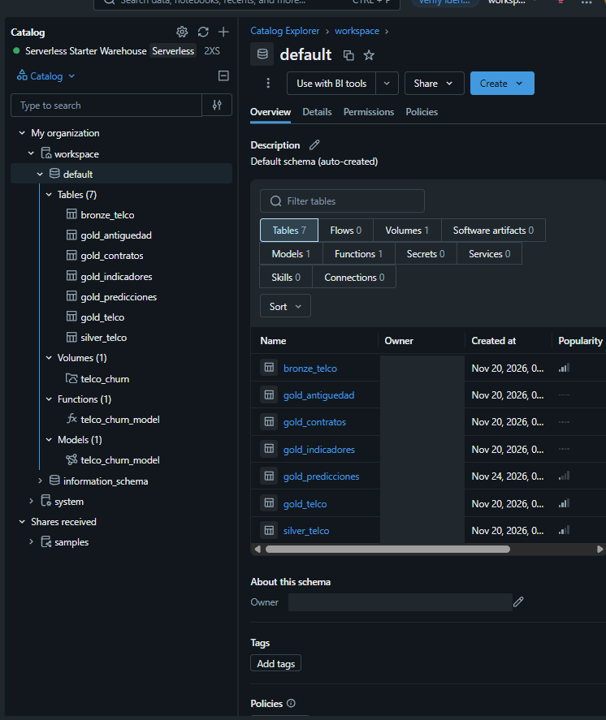


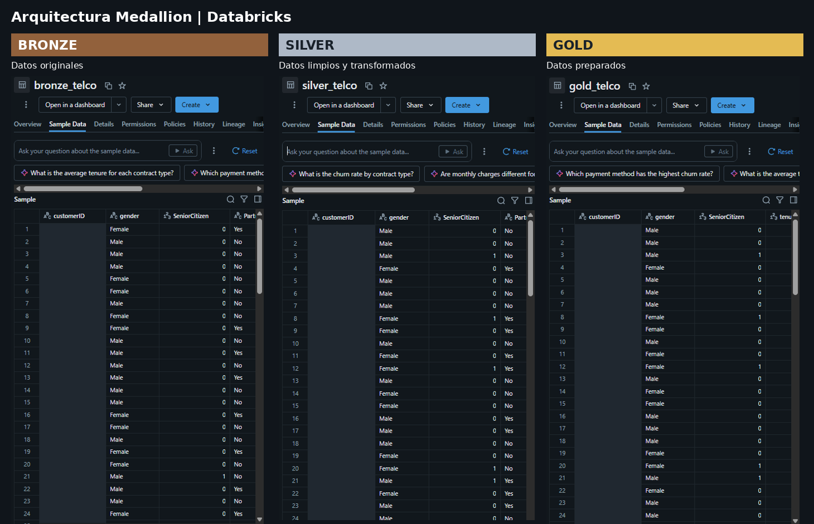


## Machine learning

Spark ML binary logistic regression is used. The random split is 80/20 with seed 42. The pipeline transforms `Contract` with StringIndexer and OneHotEncoder, combines features with VectorAssembler and fits LogisticRegression.

`Contract → StringIndexer → OneHotEncoder → VectorAssembler (+ tenure, MonthlyCharges) → LogisticRegression`

## Evaluation

Test set: 1,409 records.

| Metric | Value |
|---|---:|
| Accuracy | 78.42% |
| F1 (weighted) | 77.41% |
| AUC-ROC | 0.8217 |
| Precision (churn) | 62.59% |
| Recall (churn) | 47.61% |
| F1 (churn) | 54.08% |

| Actual / Predicted | Stays | Churns |
|---|---:|---:|
| 0 | 926 | 107 |
| 1 | 197 | 179 |

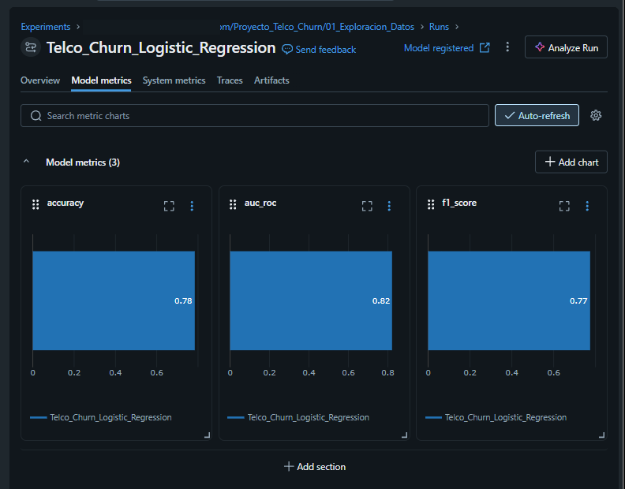


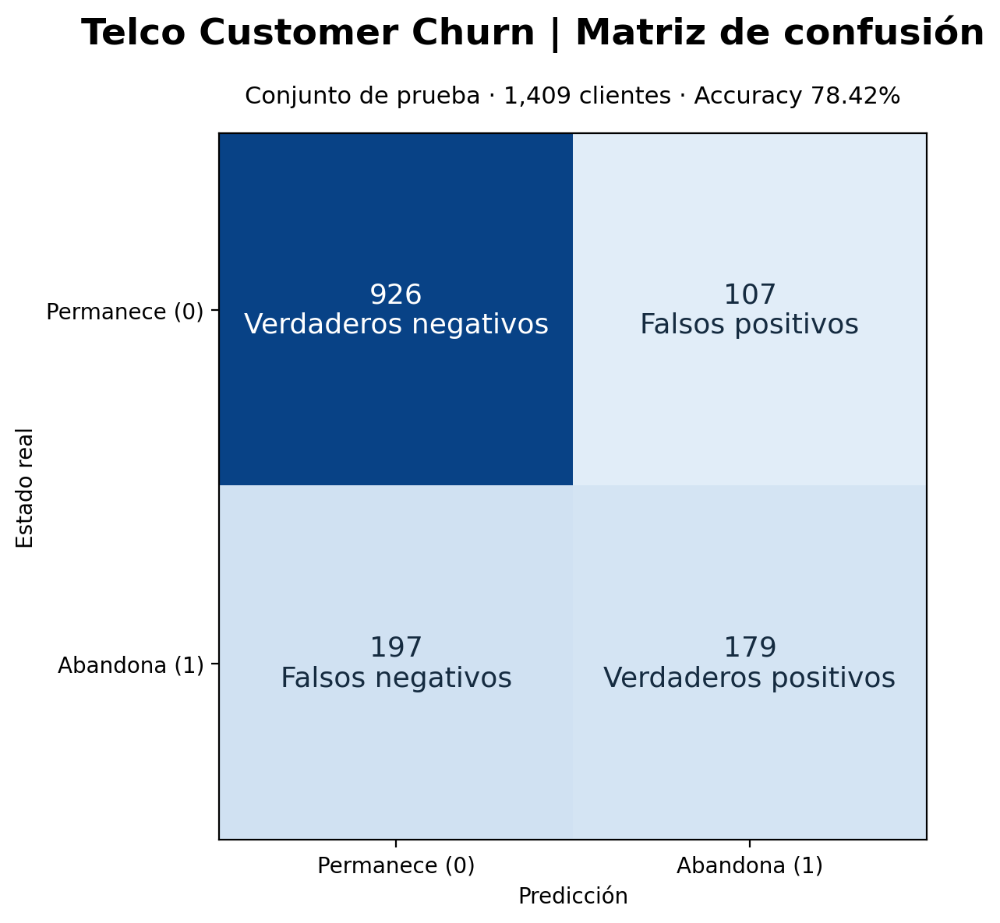

The model detects 179 of 376 actual churn cases. The 197 false negatives are a relevant limitation. MLflow metrics were logged as explicit values in the notebook; logging directly from evaluators is a recommended improvement.

## Model registry

Model registered in Unity Catalog through MLflow, version 1, with a three-feature signature. Batch inference is used, not a Model Serving endpoint.

`models:/workspace.default.telco_churn_model/1`

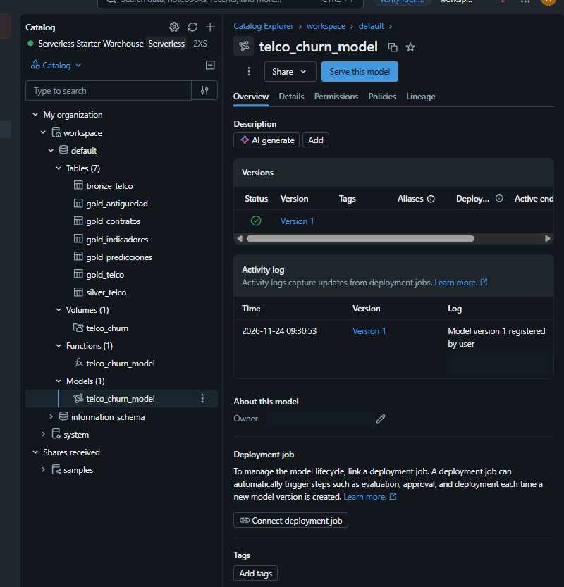


## Automation

| Job | Notebook | Compute |
|---|---|---|
| Pipeline_Telco_Churn | 01_Exploracion_Datos | Serverless |
| Pipeline_Telco_App | 02_Procesar_Nuevos_Clientes | Serverless |

The second Job receives `archivo_csv` and `id_proceso`. Streamlit starts the Job and polls its status. Results are separated by process identifier. Six successful app Job runs were observed, ranging from 68 to 154 seconds including queue time; this is not a load test.

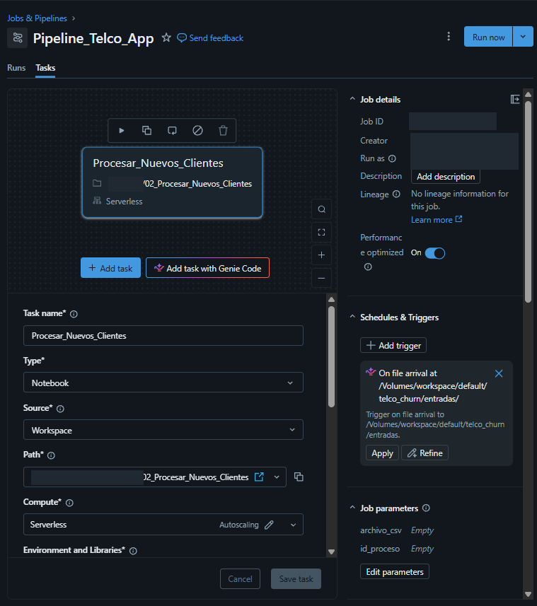


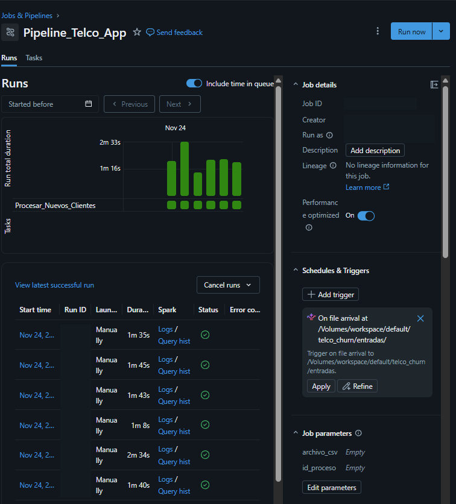


## Dashboard and application

The dashboard displays KPIs, risk distribution, tenure and priority customers. Streamlit supports CSV upload or original dataset selection, pipeline execution, charts and prediction downloads.

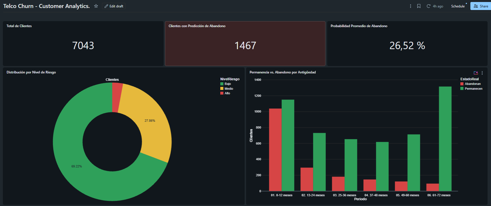


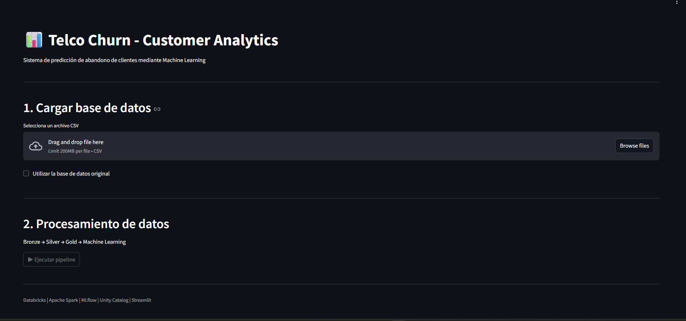


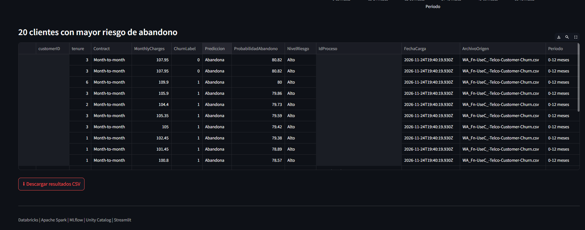


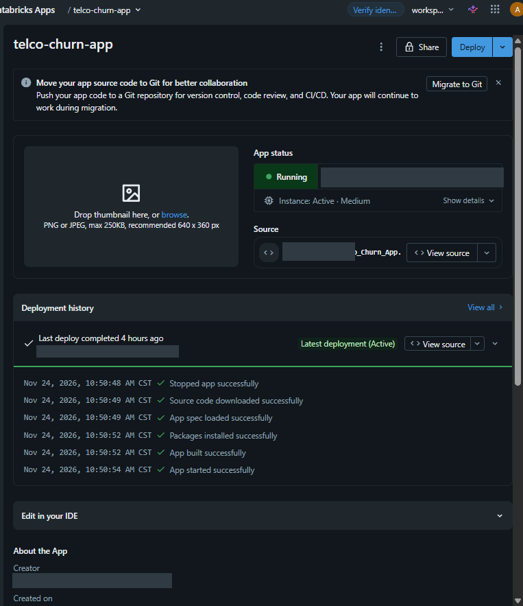


## Results

| Indicator | Result |
|---|---:|
| Customers | 7,043 |
| Predicted churn | 1,467 |
| Predicted stay | 5,576 |
| Mean probability | 26.52% |
| Actual churn | 1,869 |

These results cover the full dataset, not an independent evaluation. See [results/](results/).

## Repository structure

```text
.
├── app/
├── data/
├── docs/
├── images/
├── notebooks/
├── results/
├── scripts/
├── tests/
├── README.md
└── README_EN.md
```

The `scripts` and `tests` directories document planned work; they do not imply an executed automated test suite.

## Implementation

1. Clone the repository and import the notebooks into Databricks.
2. Create or adapt the catalog, schema and `telco_churn` volume; upload the original CSV obtained from its authorized source.
3. Review notebook paths and permissions and run `01_Exploracion_Datos` to create tables and register the model.
4. Configure both serverless Jobs; define `archivo_csv` and `id_proceso` in the second.
5. Create a Databricks App using `app/` files, configure `telco-job` and `volume` resources and permissions. `TELCO_JOB_ID` comes from the Job resource; also review the fixed volume path in the code.
6. Deploy and test with a sample CSV; check results and download.

Databricks access with Spark ML, Unity Catalog, Jobs and Apps enabled is required. Credentials are not included.

## Limitations and improvements

- Improve recall and evaluate thresholds, class balance and alternative models.
- Align risk bands: the dashboard and app currently use different low/medium boundaries (40% and 30%, respectively). The dashboard tenure chart shows actual outcomes while Streamlit shows predictions.
- Add automated validation, pinned dependencies and drift monitoring.
- The app loads data into memory with pandas and displays a 200 MB upload limit; scalability to millions of records has not been demonstrated.
- Retention intervention impact and future-customer performance have not been validated.

## References

- [IBM Telco Customer Churn (Kaggle)](https://www.kaggle.com/datasets/blastchar/telco-customer-churn)
- [Databricks](https://docs.databricks.com/)
- [Apache Spark ML](https://spark.apache.org/docs/latest/ml-guide.html)
- [MLflow](https://mlflow.org/docs/latest/)
- [Streamlit](https://docs.streamlit.io/)

Academic and portfolio project.
