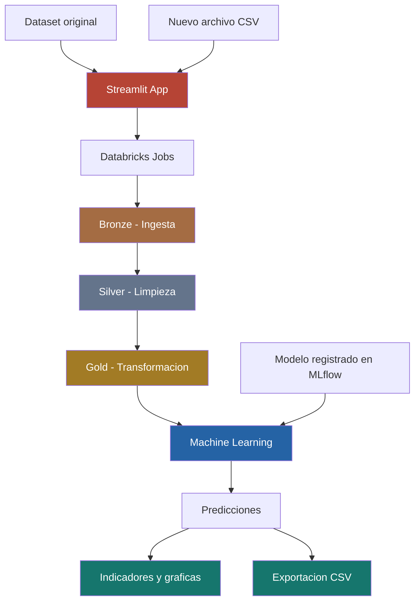
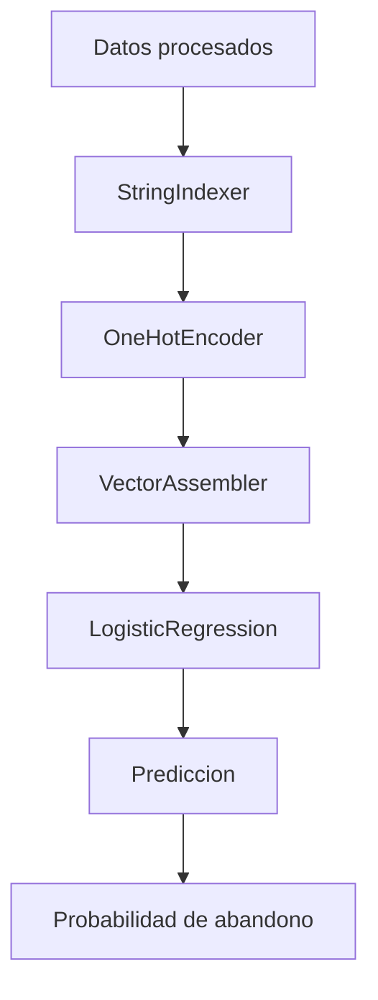

# Documentación técnica — Telco Customer Churn

## 1. Introducción

El proyecto implementa una plataforma integral de
ingeniería de datos y aprendizaje automático para
predecir el abandono de clientes en el sector de
telecomunicaciones.

La solución integra procesamiento de datos,
almacenamiento, automatización, Machine Learning
y visualización mediante Databricks.

## 2. Objetivo general

Desarrollar una plataforma capaz de procesar datos
de clientes, identificar patrones de abandono y
generar predicciones mediante un modelo de
clasificación binaria.

## 3. Objetivos específicos

- Implementar un pipeline ETL.
- Utilizar Apache Spark para procesar datos.
- Implementar la arquitectura Medallion.
- Entrenar un modelo de regresión logística.
- Evaluar el desempeño del modelo.
- Registrar y administrar el modelo con MLflow.
- Automatizar el procesamiento de nuevos clientes.
- Desarrollar una interfaz web interactiva.
- Visualizar indicadores y resultados.
- Estudiar la escalabilidad del sistema.

## 4. Arquitectura general

## 5. Stack tecnológico

| Tecnología | Función |
|---|---|
| Python | Lenguaje de programación |
| Apache Spark | Procesamiento distribuido |
| PySpark | Interfaz de Spark para Python |
| Delta Lake | Almacenamiento de tablas |
| Databricks | Plataforma de datos y ejecución |
| Unity Catalog | Administración de datos y modelos |
| MLflow | Gestión del ciclo de vida del modelo |
| Spark MLlib | Entrenamiento de Machine Learning |
| Databricks Jobs | Automatización del pipeline |
| Streamlit | Interfaz web interactiva |
| Databricks Apps | Despliegue de la aplicación |
| GitHub | Control de versiones y documentación |

## 6. Arquitectura Medallion

La arquitectura Medallion organiza los datos en
diferentes niveles de procesamiento y calidad.

### Bronze

Primera capa del procesamiento.

Responsabilidades:

- Lectura del archivo CSV.
- Ingesta de datos.
- Conservación de la información original.
- Almacenamiento en tablas Delta.

### Silver

Segunda capa del procesamiento.

Responsabilidades:

- Limpieza de datos.
- Conversión de tipos de datos.
- Tratamiento de valores faltantes.
- Eliminación de registros duplicados.
- Generación de la variable ChurnLabel.

### Gold

Tercera capa del procesamiento.

Responsabilidades:

- Preparación de datos para Machine Learning.
- Selección de variables relevantes.
- Preparación de información para análisis.
- Generación de datos de consumo analítico.

## 7. Modelo de Machine Learning

### Algoritmo

Regresión logística mediante PySpark MLlib.

### Tipo de aprendizaje

Aprendizaje supervisado.

### Tipo de problema

Clasificación binaria.

### Variables predictoras

- tenure
- MonthlyCharges
- Contract

### Variable objetivo

ChurnLabel:

- 0: Permanencia del cliente.
- 1: Abandono del cliente.

### Pipeline de Machine Learning

### División de datos

- Entrenamiento: 80%.
- Evaluación: 20%.
- Semilla aleatoria: 42.

### Métricas obtenidas

| Métrica | Resultado |
|---|---:|
| Accuracy | 0.7842 |
| F1 Score | 0.7741 |
| AUC ROC | 0.8217 |

Estas métricas corresponden a la evaluación del
modelo sobre la partición de prueba del dataset
original.

## 8. Gestión del modelo con MLflow

MLflow permite registrar y reutilizar el modelo
entrenado dentro de Databricks.

El modelo se administra mediante Unity Catalog.

### Funcionalidades

- Registro del modelo entrenado.
- Control de versiones.
- Recuperación del modelo.
- Generación de nuevas predicciones.
- Separación del entrenamiento y la inferencia.

La aplicación utiliza el modelo previamente
entrenado, evitando repetir el entrenamiento
cada vez que se carga un nuevo archivo.

## 9. Unity Catalog

Unity Catalog permite administrar los recursos
de datos y Machine Learning del proyecto.

### Recursos utilizados

- Catálogos.
- Esquemas.
- Volumes.
- Tablas Delta.
- Modelos registrados.
- Permisos de acceso.

Los archivos de entrada y los resultados del
procesamiento se almacenan mediante Volumes.

## 10. Automatización mediante Databricks Jobs

El procesamiento de nuevos clientes se ejecuta
mediante un Job de Databricks.

### Nombre del Job

Pipeline_Telco_App

### Notebook asociado

02_Procesar_Nuevos_Clientes

### Parámetros

| Parámetro | Función |
|---|---|
| archivo_csv | Ruta del archivo de entrada |
| id_proceso | Identificador de la ejecución |

### Flujo de ejecución

1. Recepción del archivo.
2. Validación de la estructura.
3. Procesamiento Bronze.
4. Procesamiento Silver.
5. Procesamiento Gold.
6. Recuperación del modelo registrado.
7. Generación de predicciones.
8. Almacenamiento de resultados.
9. Visualización en la aplicación.

## 11. Aplicación web

La interfaz se desarrolla mediante Streamlit
y se despliega utilizando Databricks Apps.

### Funcionalidades

- Selección del dataset original.
- Carga de nuevos archivos CSV.
- Ejecución del pipeline.
- Consulta del estado del procesamiento.
- Visualización de indicadores.
- Visualización de niveles de riesgo.
- Descarga de resultados.

## 12. Seguridad y administración

El proyecto utiliza los mecanismos de permisos
y autenticación disponibles en Databricks.

No se deben almacenar en GitHub:

- Tokens de acceso.
- Contraseñas.
- Credenciales personales.
- Secretos de autenticación.
- Datos confidenciales.

La configuración de recursos debe realizarse
dentro del entorno de despliegue.

