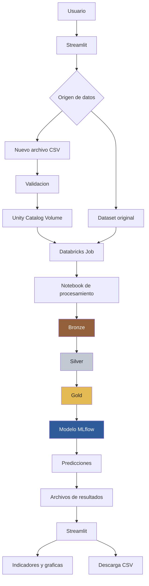
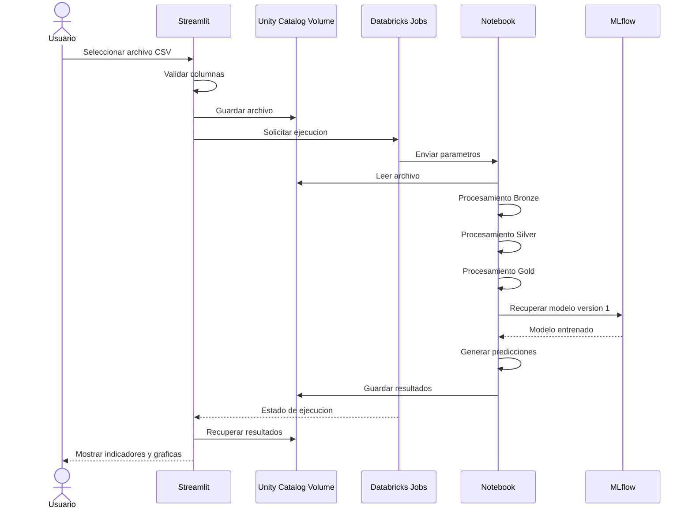
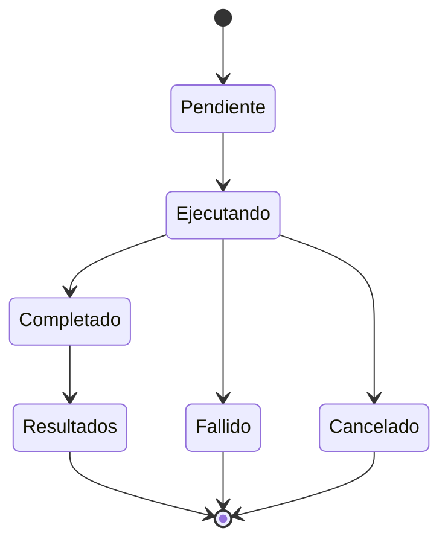

# Databricks Jobs y automatización

## 1. Introducción

El proyecto Telco Customer Churn implementa
un sistema automatizado de procesamiento de
datos mediante Databricks Jobs.

La automatización permite ejecutar el pipeline
de ingeniería de datos y Machine Learning
desde una aplicación web desarrollada con
Streamlit, sin que el usuario tenga que
interactuar directamente con los notebooks.

## 2. Objetivos

- Automatizar el procesamiento de archivos CSV.
- Reducir la intervención manual.
- Reutilizar el modelo previamente entrenado.
- Administrar ejecuciones independientes.
- Facilitar la trazabilidad de los procesos.
- Integrar la aplicación con Databricks.
- Presentar resultados de manera interactiva.

## 3. Tecnologías utilizadas

| Tecnología | Responsabilidad |
|---|---|
| Databricks Jobs | Orquestación del pipeline |
| Serverless Compute | Recursos computacionales |
| Databricks SDK | Comunicación con Databricks |
| Streamlit | Interfaz de usuario |
| PySpark | Procesamiento de datos |
| Delta Lake | Almacenamiento de datos |
| Unity Catalog | Administración de recursos |
| MLflow | Recuperación del modelo |
| Pandas | Manipulación de resultados |
| Plotly | Visualización interactiva |

## 4. Arquitectura general



## 5. Configuración del Job

| Propiedad | Valor |
|---|---|
| Nombre | Pipeline_Telco_App |
| Tarea | Procesar_Nuevos_Clientes |
| Tipo | Notebook |
| Compute | Serverless |
| Activación | Bajo demanda |
| Notebook | 02_Procesar_Nuevos_Clientes |

El identificador del Job es específico
de cada entorno de Databricks.

Por este motivo, la versión publicada
de la aplicación utiliza una variable
de entorno para obtener dicho identificador.

## 6. Parámetros de ejecución

El notebook recibe dos parámetros principales.

| Parámetro | Tipo | Descripción |
|---|---|---|
| archivo_csv | String | Ruta del archivo de entrada |
| id_proceso | String | Identificador de ejecución |

Estos parámetros permiten procesar diferentes
archivos utilizando el mismo notebook.

## 7. Databricks Widgets

Los parámetros se reciben mediante widgets.

Ejemplo conceptual:

```python
dbutils.widgets.text("archivo_csv", "")
dbutils.widgets.text("id_proceso", "")

archivo_csv = dbutils.widgets.get("archivo_csv")
id_proceso = dbutils.widgets.get("id_proceso")
```

El notebook utiliza estos valores para
identificar el archivo que debe procesar
y organizar los resultados de la ejecución.

Cuando no se proporciona un archivo,
el notebook contempla el dataset original
como alternativa de procesamiento.

## 8. Origen de los datos

La aplicación permite seleccionar dos
modalidades de procesamiento.

### Dataset original

Utiliza el archivo IBM Telco Customer Churn
almacenado previamente en Unity Catalog.

### Nuevo archivo CSV

Permite cargar un conjunto de datos
compatible desde la computadora del usuario.

Las dos modalidades son independientes.

Cuando la opción de utilizar el dataset
original está activada, este tiene prioridad
sobre el archivo cargado.

Los datasets no se combinan automáticamente.

## 9. Validación de archivos

Para realizar nuevas predicciones se
requieren las siguientes columnas:

| Columna | Tipo esperado |
|---|---|
| customerID | String |
| tenure | Integer |
| MonthlyCharges | Double |
| Contract | String |

Las columnas adicionales pueden formar
parte del archivo de entrada.

La variable Churn no es indispensable
para generar nuevas predicciones.

## 10. Identificación de procesos

Cada ejecución utiliza un identificador
para organizar los archivos de entrada
y los resultados correspondientes.

La aplicación utiliza identificadores
únicos para los archivos cargados.

Esto facilita la separación de ejecuciones
y reduce los conflictos entre nombres
de archivos.

## 11. Almacenamiento

Ruta base:

    /Volumes/workspace/default/telco_churn/

Organización general:

    telco_churn/
    ├── Dataset original CSV
    ├── entradas/
    ├── resultados/
    │   └── id_proceso/
    └── mlflow_tmp/

La carpeta entradas almacena los archivos
cargados desde la aplicación.

La carpeta resultados contiene los archivos
generados durante cada ejecución.

La carpeta mlflow_tmp se utiliza para
operaciones temporales relacionadas
con modelos Spark y MLflow.

## 12. Secuencia de ejecución



## 13. Integración mediante Databricks SDK

La aplicación utiliza Databricks SDK
para interactuar con los recursos
configurados en el Workspace.

Ejemplo simplificado de ejecución:

```python
from databricks.sdk import WorkspaceClient
import os

w = WorkspaceClient()

job_id = int(os.environ["TELCO_JOB_ID"])

run = w.jobs.run_now(
    job_id=job_id,
    job_parameters={
        "archivo_csv": ruta_archivo,
        "id_proceso": identificador
    }
)
```

Las variables ruta_archivo e identificador
representan valores proporcionados por
la aplicación.

El ejemplo es ilustrativo. La implementación
completa se encuentra en app/app.py.

## 14. Configuración de Databricks Apps

La aplicación utiliza el archivo app.yaml
para establecer su comando de ejecución
y las referencias a los recursos.

```yaml
command:
  - streamlit
  - run
  - app.py

env:
  - name: TELCO_JOB_ID
    valueFrom: telco-job

  - name: TELCO_VOLUME
    valueFrom: volume
```

Los recursos telco-job y volume deben
configurarse dentro de Databricks Apps.

La ruta del Volume utilizada por el código
también debe revisarse al desplegar
la aplicación en otro Workspace.

## 15. Recursos de la aplicación

| Recurso | Clave |
|---|---|
| Databricks Job | telco-job |
| Unity Catalog Volume | volume |

La aplicación necesita permisos para
solicitar ejecuciones del Job y acceder
a los archivos correspondientes.

## 16. Estados de ejecución

La aplicación consulta periódicamente
el estado del proceso solicitado.

El flujo general puede representarse
mediante los siguientes estados:



Estos estados son una representación
conceptual del ciclo de ejecución.

La aplicación consulta el estado del Job
aproximadamente cada cinco segundos.

## 17. Procesamiento automatizado

Durante cada ejecución se realizan
las siguientes operaciones:

1. Recepción de parámetros.
2. Lectura del archivo CSV.
3. Validación de datos.
4. Procesamiento Bronze.
5. Procesamiento Silver.
6. Preparación Gold.
7. Recuperación del modelo registrado.
8. Generación de predicciones.
9. Clasificación de niveles de riesgo.
10. Exportación de resultados.

No se realiza un nuevo entrenamiento
del modelo durante cada ejecución.

## 18. Resultados generados

La aplicación presenta información como:

- Cantidad de clientes procesados.
- Clientes con predicción de permanencia.
- Clientes con predicción de abandono.
- Probabilidad promedio de abandono.
- Distribución de niveles de riesgo.
- Análisis por tipo de contrato.
- Análisis por antigüedad.
- Clientes con mayor riesgo.
- Descarga de predicciones en CSV.

## 19. Prueba de ejecución

Durante el desarrollo se verificó
una ejecución manual exitosa del Job
utilizando el dataset original.

| Indicador | Resultado |
|---|---|
| Registros procesados | 7,043 |
| Estado | Exitoso |
| Tiempo registrado | 2 min 32 s |
| Modelo utilizado | Versión 1 |

El tiempo corresponde a una ejecución
observada durante el desarrollo.

No representa un promedio estadístico
ni una garantía de rendimiento.

## 20. Consumo de recursos

El procesamiento utiliza recursos
computacionales de Databricks.

El consumo depende de factores como:

- Cantidad de registros.
- Tamaño del archivo.
- Complejidad de las transformaciones.
- Operaciones de lectura y escritura.
- Recursos computacionales disponibles.
- Cantidad de ejecuciones.
- Recuperación del modelo.
- Generación de resultados.

Databricks Free Edition está sujeto
a cuotas y restricciones de uso.

El pipeline no utiliza una API de
inteligencia artificial generativa
para realizar las predicciones.

Por lo tanto, no depende del consumo
de tokens de un modelo de lenguaje.

## 21. Escalabilidad

La arquitectura utiliza Apache Spark
para el procesamiento de datos.

Sin embargo, la capacidad total también
depende de la aplicación Streamlit,
el almacenamiento y el uso de Pandas.

Se propone evaluar los siguientes niveles:

| Nivel | Registros |
|---|---:|
| Funcional | 2,000 |
| Básico | 10,000 |
| Intermedio | 100,000 |
| Avanzado | 500,000 |
| Escalabilidad | 1,000,000 |
| Big Data | 4,000,000 |

Estos niveles constituyen un plan
de pruebas futuras.

No representan capacidades máximas
verificadas experimentalmente.

## 22. Seguridad

El repositorio no debe contener:

- Tokens de acceso.
- Contraseñas.
- Credenciales personales.
- Secretos de autenticación.

Los identificadores de recursos deben
configurarse según el entorno utilizado.

Se recomienda aplicar el principio
de mínimo privilegio.

## 23. Reproducción del Job

Para reproducir la automatización:

1. Importar los notebooks a Databricks.
2. Configurar Unity Catalog.
3. Crear el Volume de almacenamiento.
4. Obtener el dataset original.
5. Ejecutar el notebook de entrenamiento.
6. Registrar el modelo en MLflow.
7. Crear un Databricks Job.
8. Seleccionar el notebook de inferencia.
9. Configurar los parámetros.
10. Configurar los recursos de la aplicación.
11. Asignar los permisos necesarios.
12. Desplegar la aplicación.
13. Ejecutar una prueba funcional.

## 24. Limitaciones actuales

- Dependencia de Databricks Free Edition.
- Cuotas de procesamiento.
- Tamaño máximo de carga de archivos.
- Uso de Pandas para visualizar resultados.
- Capacidad máxima pendiente de evaluación.
- Monitoreo avanzado no implementado.
- Reentrenamiento automático pendiente.
- Pruebas de concurrencia pendientes.

## 25. Mejoras futuras

- Procesamiento de archivos de mayor tamaño.
- Visualización mediante datos agregados.
- Monitoreo de tiempos de ejecución.
- Registro centralizado de errores.
- Notificaciones de ejecución.
- Pruebas automatizadas.
- Control de ejecuciones concurrentes.
- Limpieza automática de archivos temporales.
- Programación de ejecuciones periódicas.
- Integración continua y despliegue continuo.
- Automatización del reentrenamiento.

## 26. Documentación relacionada

- [Arquitectura Medallion](medallion_architecture.md)
- [Machine Learning](machine_learning.md)
- [MLflow y Unity Catalog](mlflow_unity_catalog.md)
- [Notebook de inferencia](../notebooks/02_Procesar_Nuevos_Clientes.ipynb)
- [Aplicación Streamlit](../app/)
- [Datasets](../data/)
- [Pruebas](../tests/)
- [Resultados](../results/)

## 27. Referencias oficiales

- [Databricks](https://docs.databricks.com/)
- [Databricks SDK](https://databricks-sdk-py.readthedocs.io/)
- [Streamlit](https://docs.streamlit.io/)
- [Apache Spark](https://spark.apache.org/docs/latest/)
- [MLflow](https://mlflow.org/docs/latest/)
