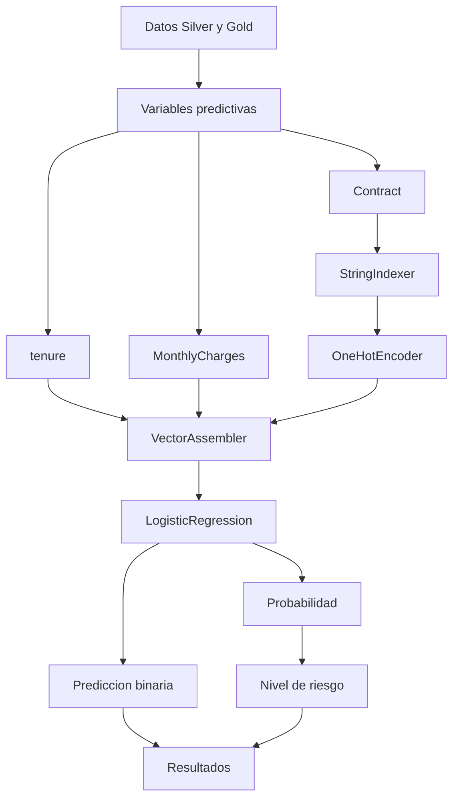
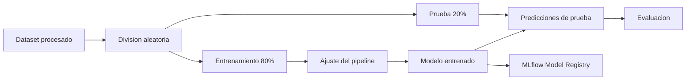
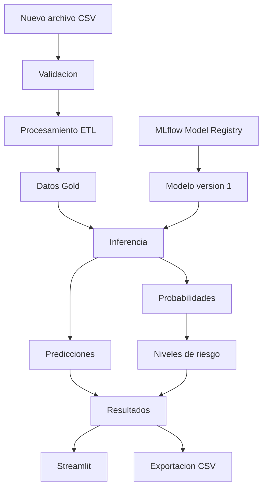

# Machine Learning — Customer Churn Prediction

## 1. Introducción

El proyecto implementa un modelo de clasificación
binaria para estimar la probabilidad de abandono
de clientes de una empresa de telecomunicaciones.

El modelo fue desarrollado mediante Apache Spark
MLlib dentro de Databricks, utilizando regresión
logística como algoritmo de clasificación.

## 2. Objetivo

Identificar clientes con probabilidad de abandonar
el servicio, proporcionando información que pueda
apoyar estrategias de retención.

## 3. Tipo de aprendizaje

| Característica | Descripción |
|---|---|
| Aprendizaje | Supervisado |
| Problema | Clasificación binaria |
| Algoritmo | Regresión logística |
| Framework | PySpark MLlib |
| Variable objetivo | ChurnLabel |
| Gestión del modelo | MLflow |
| Plataforma | Databricks |

## 4. Dataset de entrenamiento

Se utilizó el dataset IBM Telco Customer Churn.

| Característica | Valor |
|---|---:|
| Registros originales | 7,043 |
| Columnas originales | 21 |
| Clientes con Churn = No | 5,174 |
| Clientes con Churn = Yes | 1,869 |
| Proporción de abandono | 26.54% |

El dataset corresponde a un caso de estudio
de telecomunicaciones con datos ficticios.

## 5. Variables predictivas

El modelo utiliza tres variables de entrada.

| Variable | Tipo | Descripción |
|---|---|---|
| tenure | Numérica | Antigüedad en meses |
| MonthlyCharges | Numérica | Cargo mensual |
| Contract | Categórica | Modalidad de contrato |

Las categorías de contrato son:

- Month-to-month.
- One year.
- Two year.

El identificador customerID se utiliza para
relacionar los resultados con cada cliente,
pero no constituye una característica predictiva.

## 6. Variable objetivo

La variable Churn se transforma en una
representación numérica binaria.

| Churn | ChurnLabel | Interpretación |
|---|---:|---|
| No | 0 | El cliente permanece |
| Yes | 1 | El cliente abandona |

## 7. Preparación de características

El pipeline de Machine Learning utiliza:

### StringIndexer

Convierte las categorías de Contract en
índices numéricos.

### OneHotEncoder

Transforma los índices categóricos en una
representación vectorial.

### VectorAssembler

Combina las variables numéricas y categóricas
transformadas en un vector de características.

## 8. Arquitectura del pipeline

## 9. Regresión logística

La regresión logística es un algoritmo de
clasificación que permite estimar la probabilidad
de pertenecer a una determinada clase.

La combinación lineal de las características
se representa mediante:

$$
z = \beta_0 + \sum_{i=1}^{n}\beta_i x_i
$$

Donde:

- x representa las características transformadas.
- beta representa los coeficientes aprendidos.
- beta cero representa el intercepto.

### Función sigmoide

$$
P(y=1|x)=\frac{1}{1+e^{-z}}
$$

La función transforma cualquier valor real
en una probabilidad entre cero y uno.

### Regla de clasificación

Con el umbral estándar de 0.5:

$$
\hat{y} =
\begin{cases}
1 & p \geq 0.5 \\
0 & p < 0.5
\end{cases}
$$

Una predicción de uno representa abandono
y una predicción de cero representa permanencia.

## 10. Función de pérdida

La regresión logística binaria utiliza una
función de pérdida logarítmica.

$$
L=-\frac{1}{m}\sum_{i=1}^{m}
[y_i\log(p_i)+(1-y_i)\log(1-p_i)]
$$

Donde:

- m es el número de observaciones.
- y es la etiqueta original.
- p es la probabilidad estimada.

El entrenamiento busca minimizar esta pérdida,
considerando la regularización cuando corresponda.

## 11. División de datos

El dataset fue dividido mediante randomSplit.

| Conjunto | Proporción configurada |
|---|---:|
| Entrenamiento | 80% |
| Prueba | 20% |

Semilla aleatoria utilizada: 42.

Las proporciones representan la configuración
de la división aleatoria, no necesariamente
los porcentajes exactos obtenidos.

## 12. Entrenamiento

## 13. Resultados de evaluación

| Métrica | Resultado |
|---|---:|
| Accuracy | 0.7842 |
| F1 Score ponderado | 0.7741 |
| AUC-ROC | 0.8217 |

### Accuracy

Proporción de predicciones correctas.

$$
Accuracy=\frac{TP+TN}{TP+TN+FP+FN}
$$

### Precision

Proporción de positivos predichos que
realmente pertenecen a la clase positiva.

$$
Precision=\frac{TP}{TP+FP}
$$

### Recall

Proporción de positivos identificados
correctamente por el modelo.

$$
Recall=\frac{TP}{TP+FN}
$$

### F1 Score

Media armónica entre Precision y Recall.

$$
F1=2\frac{Precision \cdot Recall}
{Precision+Recall}
$$

El resultado reportado por el evaluador
multiclase de Spark corresponde al F1
ponderado por el soporte de cada clase.

### AUC-ROC

Mide la capacidad del modelo para distinguir
entre clientes que abandonan y permanecen
a través de diferentes umbrales.

Un valor de 0.5 representa una capacidad
de discriminación equivalente al azar.

Un valor de 1.0 representa discriminación
perfecta.

## 14. Matriz de confusión

| Clase original | Predicción 0 | Predicción 1 |
|---|---|---|
| Permanece | Verdadero negativo | Falso positivo |
| Abandona | Falso negativo | Verdadero positivo |

La matriz permite identificar los tipos de
errores cometidos por el modelo.

Los valores numéricos de la matriz deberán
consultarse en las evidencias de evaluación
del notebook original.

## 15. Resultados sobre el dataset original

Al aplicar el modelo al conjunto completo
de 7,043 registros se obtuvieron:

| Indicador | Resultado |
|---|---:|
| Clientes procesados | 7,043 |
| Predicción de permanencia | 5,576 |
| Predicción de abandono | 1,467 |
| Abandono predicho | 20.83% |
| Probabilidad promedio de abandono | 26.52% |

Estos resultados corresponden a inferencia
sobre el dataset completo y no constituyen
una evaluación independiente del modelo.

Las etiquetas originales y las predicciones
representan conceptos diferentes.

## 16. Clasificación de riesgo

La probabilidad estimada se utiliza para
clasificar a los clientes en tres niveles.

### Dashboard original

| Riesgo | Probabilidad |
|---|---|
| Bajo | Menor a 0.40 |
| Medio | Desde 0.40 y menor a 0.70 |
| Alto | Desde 0.70 |

### Aplicación Streamlit

| Riesgo | Probabilidad |
|---|---|
| Bajo | Menor a 0.30 |
| Medio | Desde 0.30 y menor a 0.70 |
| Alto | Desde 0.70 |

Los dos componentes utilizan umbrales
diferentes para el riesgo bajo y medio.

Se propone unificar estos criterios
en una versión posterior del proyecto.

La clasificación de riesgo es independiente
del umbral de clasificación binaria.

## 17. Registro del modelo

El modelo entrenado fue registrado en
MLflow mediante Unity Catalog.

| Recurso | Valor |
|---|---|
| Catálogo | workspace |
| Esquema | default |
| Modelo | telco_churn_model |
| Versión | 1 |

URI del modelo:

    models:/workspace.default.telco_churn_model/1

## 18. Inferencia automatizada

La aplicación reutiliza el modelo registrado
para procesar nuevos archivos CSV.

No se realiza un nuevo entrenamiento cada
vez que se carga un archivo.

## 19. Limitaciones

- El modelo utiliza solamente tres variables
  predictivas.
- El dataset original es un caso de estudio
  con datos ficticios.
- Existe un desequilibrio entre las clases.
- No se ha realizado una validación externa
  con clientes reales.
- Los datos sintéticos permiten evaluar
  funcionalidad, no generalización predictiva.
- Los umbrales de riesgo requieren unificación.
- No se ha verificado la calibración de las
  probabilidades.
- No se han evaluado todos los posibles sesgos.

## 20. Mejoras futuras

- Incorporar características adicionales.
- Validación cruzada.
- Optimización de hiperparámetros.
- Evaluación de Random Forest.
- Evaluación de Gradient Boosted Trees.
- Comparación de algoritmos.
- Análisis de importancia de variables.
- Optimización del umbral de clasificación.
- Calibración de probabilidades.
- Monitoreo de data drift.
- Reentrenamiento automatizado.
- Evaluación con datos externos.

## 21. Código fuente relacionado

- [Notebook de entrenamiento](../notebooks/01_Exploracion_Datos.ipynb)
- [Notebook de inferencia](../notebooks/02_Procesar_Nuevos_Clientes.ipynb)
- [Arquitectura Medallion](medallion_architecture.md)
- [Diccionario de datos](../data/data_dictionary.md)
- [Aplicación Streamlit](../app/)
- [Resultados experimentales](../results/)
