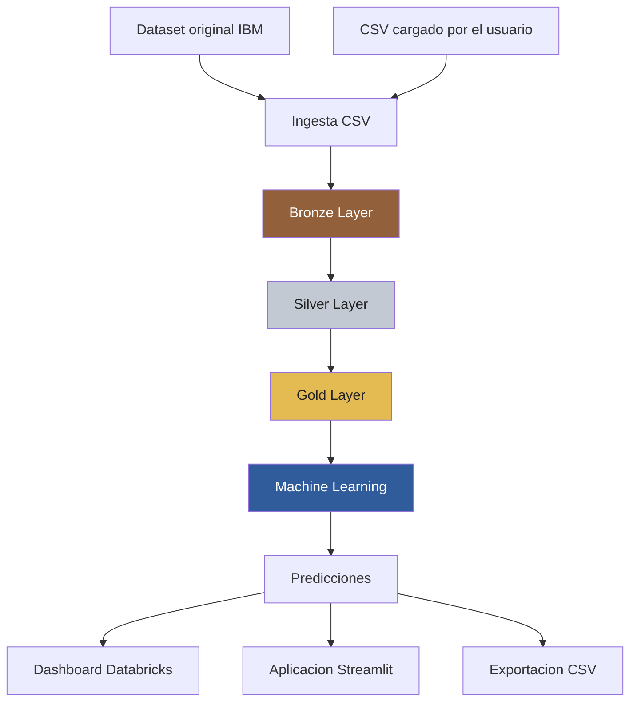
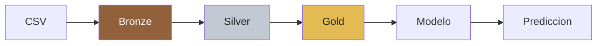
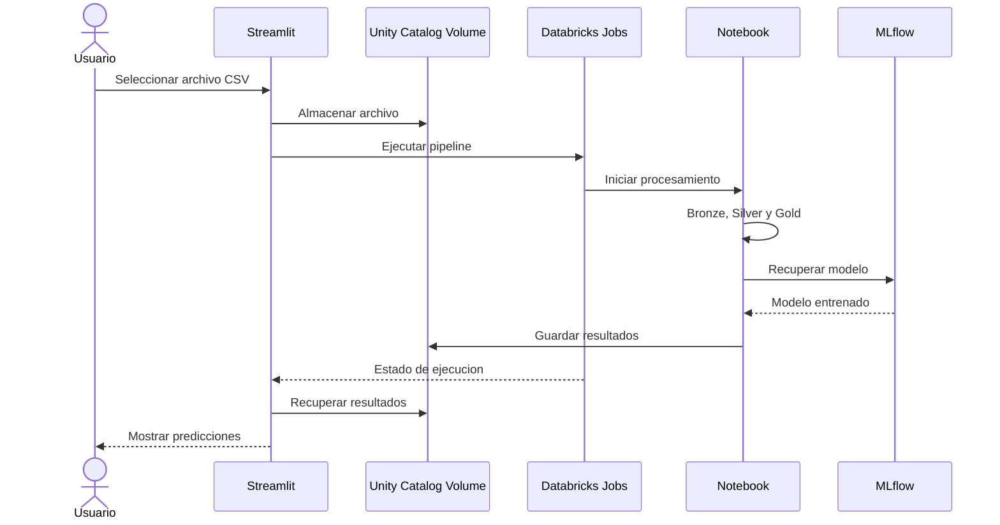

# Arquitectura Medallion

## 1. Introducción

El proyecto Telco Customer Churn implementa una
arquitectura Medallion sobre Databricks para
organizar el procesamiento de datos en tres
capas: Bronze, Silver y Gold.

Esta arquitectura permite separar la ingesta,
la limpieza y la preparación de los datos para
análisis y Machine Learning.

## 2. Arquitectura general

## 3. Tecnologías utilizadas

| Tecnología | Responsabilidad |
|---|---|
| Databricks | Plataforma de procesamiento |
| Apache Spark | Procesamiento distribuido |
| PySpark | Transformación de datos |
| Delta Lake | Almacenamiento de tablas |
| Unity Catalog | Administración de recursos |
| MLflow | Gestión del modelo |
| Databricks Jobs | Automatización |
| Streamlit | Interfaz de usuario |
| Plotly | Visualización interactiva |

## 4. Capa Bronze

### Objetivo

Conservar los datos de entrada antes de aplicar
las transformaciones de limpieza.

### Operaciones

- Lectura de archivos CSV.
- Identificación de columnas.
- Ingesta de registros.
- Almacenamiento mediante Delta Lake.
- Conservación de los datos de origen.

### Tabla original

`workspace.default.bronze_telco`

### Dataset de entrenamiento

- Registros: 7,043.
- Variables: 21.
- Formato de entrada: CSV.

## 5. Capa Silver

### Objetivo

Mejorar la calidad y consistencia de los datos
para su procesamiento posterior.

### Transformaciones

- Eliminación de identificadores duplicados.
- Conversión de tipos de datos.
- Tratamiento de valores faltantes.
- Conversión de TotalCharges a formato numérico.
- Codificación de Churn cuando está disponible.

### Codificación de la variable objetivo

| Churn | ChurnLabel |
|---|---:|
| No | 0 |
| Yes | 1 |

### Tabla original

`workspace.default.silver_telco`

## 6. Capa Gold

### Objetivo

Preparar los datos para análisis, visualización
y generación de predicciones.

### Variables predictivas

| Variable | Descripción |
|---|---|
| tenure | Antigüedad del cliente |
| MonthlyCharges | Cargo mensual |
| Contract | Tipo de contrato |

El identificador customerID permite relacionar
cada predicción con su cliente correspondiente.

### Tablas del proyecto

| Tabla | Propósito |
|---|---|
| gold_telco | Datos preparados |
| gold_predicciones | Predicciones del modelo |
| gold_indicadores | Indicadores generales |
| gold_contratos | Análisis por contrato |
| gold_antiguedad | Análisis por antigüedad |

## 7. Flujo de transformación

## 8. Entrenamiento e inferencia

El proyecto separa el entrenamiento del modelo
de la generación de nuevas predicciones.

### Entrenamiento

Notebook:

`01_Exploracion_Datos.ipynb`

Responsabilidades:

- Exploración de datos.
- Procesamiento ETL.
- Preparación de características.
- Entrenamiento de regresión logística.
- Evaluación del modelo.
- Registro mediante MLflow.

### Inferencia

Notebook:

`02_Procesar_Nuevos_Clientes.ipynb`

Responsabilidades:

- Recepción de parámetros.
- Lectura de nuevos archivos CSV.
- Procesamiento Medallion.
- Recuperación del modelo registrado.
- Generación de predicciones.
- Clasificación de riesgo.
- Exportación de resultados.

La inferencia reutiliza el modelo entrenado
sin realizar un nuevo entrenamiento.

## 9. Automatización del procesamiento

## 10. Almacenamiento

Ruta utilizada en el entorno original:

    /Volumes/workspace/default/telco_churn/

Organización:

    telco_churn/
    ├── Dataset original CSV
    ├── entradas/
    ├── resultados/
    └── mlflow_tmp/

Los archivos de entrada y los resultados de
cada ejecución se organizan mediante un
identificador de proceso.

## 11. Esquema mínimo de entrada

Para generar nuevas predicciones se requieren:

- customerID
- tenure
- MonthlyCharges
- Contract

La variable Churn es opcional durante la
inferencia, debido a que el objetivo consiste
en predecir el abandono del cliente.

## 12. Beneficios de la arquitectura

- Separación de responsabilidades.
- Organización del procesamiento.
- Reutilización del modelo.
- Trazabilidad de las ejecuciones.
- Facilidad de mantenimiento.
- Integración con herramientas analíticas.
- Posibilidad de ampliar el volumen de datos.

## 13. Limitaciones actuales

- Recursos sujetos a Databricks Free Edition.
- Carga de archivos limitada por la aplicación.
- Uso de Pandas para visualizar resultados.
- Capacidad máxima pendiente de evaluación.
- Diferencias en los umbrales de riesgo entre
  el dashboard original y la aplicación web.

La capacidad para procesar cuatro millones
de registros constituye un objetivo futuro,
no un resultado experimental verificado.

## 14. Código fuente relacionado

- [Notebooks](../notebooks/)
- [Aplicación Streamlit](../app/)
- [Datasets](../data/)
- [Diccionario de datos](../data/data_dictionary.md)
- [Resultados](../results/)
- [Estrategia de pruebas](../tests/)
