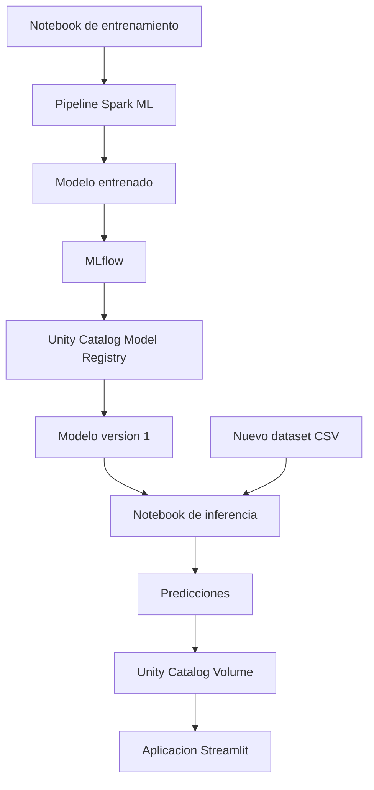
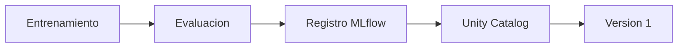
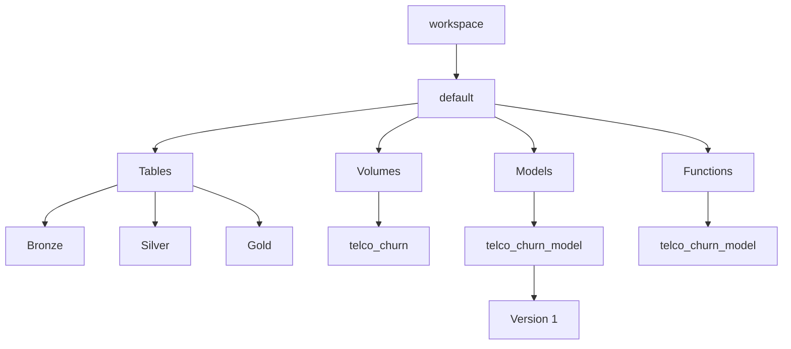
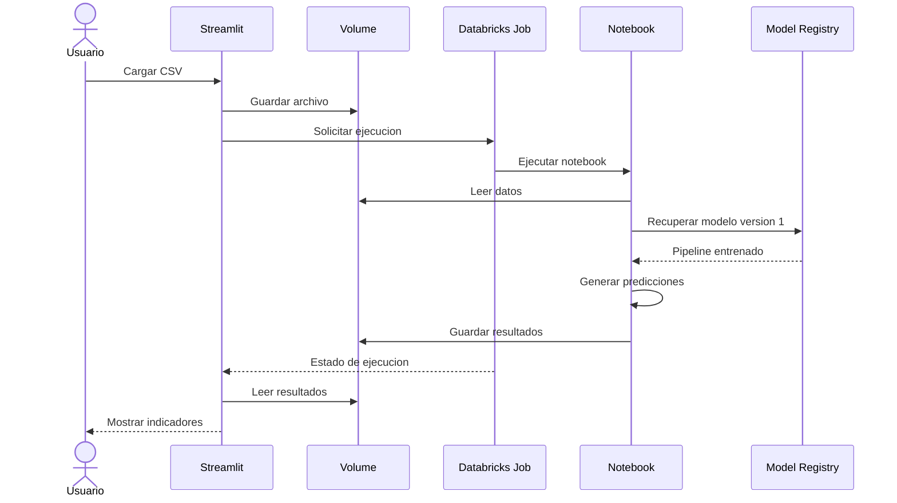

# MLflow y Unity Catalog

## 1. Introducción

El proyecto Telco Customer Churn integra MLflow
y Unity Catalog para administrar el modelo de
Machine Learning y los recursos de datos
utilizados durante el procesamiento.

Esta integración permite separar el entrenamiento
del modelo de su utilización en nuevos conjuntos
de datos.

## 2. Objetivos

- Centralizar los recursos del proyecto.
- Registrar el modelo entrenado.
- Administrar versiones del modelo.
- Facilitar la reproducibilidad.
- Reutilizar el modelo durante la inferencia.
- Organizar los archivos de entrada y salida.
- Controlar los permisos de acceso.

## 3. Tecnologías utilizadas

| Tecnología | Responsabilidad |
|---|---|
| MLflow | Gestión del ciclo de vida del modelo |
| Model Registry | Registro y versionado |
| Unity Catalog | Gobernanza de datos y modelos |
| Delta Lake | Almacenamiento de tablas |
| Unity Catalog Volumes | Almacenamiento de archivos |
| Apache Spark | Procesamiento distribuido |
| Databricks Jobs | Orquestación de ejecuciones |

## 4. Arquitectura general



## 5. MLflow

MLflow es una plataforma para administrar
el ciclo de vida de modelos de Machine Learning.

Sus componentes permiten gestionar:

- Experimentos.
- Parámetros.
- Métricas.
- Artefactos.
- Modelos entrenados.
- Versiones de modelos.

En este proyecto se utiliza principalmente
para registrar y recuperar el pipeline
entrenado mediante PySpark MLlib.

## 6. Modelo registrado

| Propiedad | Valor |
|---|---|
| Catálogo | workspace |
| Esquema | default |
| Nombre | telco_churn_model |
| Versión | 1 |
| Algoritmo | Regresión logística |
| Framework | PySpark MLlib |
| Tipo | Clasificación binaria |

Nombre completo:

    workspace.default.telco_churn_model

URI del modelo:

    models:/workspace.default.telco_churn_model/1

La URI identifica una versión específica
del modelo registrado.

## 7. Métricas del modelo

| Métrica | Resultado |
|---|---:|
| Accuracy | 0.7842 |
| F1 Score ponderado | 0.7741 |
| AUC-ROC | 0.8217 |

Estos valores corresponden a la evaluación
realizada durante el desarrollo del modelo.

## 8. Configuración de MLflow

El proyecto utiliza Unity Catalog como
registro de modelos.

```python
import mlflow
import mlflow.spark
import os

mlflow.set_registry_uri("databricks-uc")

os.environ["MLFLOW_DFS_TMP"] = (
    "/Volumes/workspace/default/"
    "telco_churn/mlflow_tmp"
)
```

La variable MLFLOW_DFS_TMP establece una
ubicación temporal para las operaciones
de MLflow con modelos Spark.

La ruta deberá adaptarse cuando el proyecto
se implemente en otro Workspace.

## 9. Registro del modelo

El modelo entrenado se registra bajo un
nombre de tres niveles:

    catalogo.esquema.modelo

Flujo conceptual:



El procedimiento completo de entrenamiento
y registro se encuentra en:

[01_Exploracion_Datos](../notebooks/01_Exploracion_Datos.ipynb)

## 10. Recuperación del modelo

Para generar nuevas predicciones se recupera
la versión registrada del pipeline.

```python
import mlflow.spark

model_uri = (
    "models:/workspace.default."
    "telco_churn_model/1"
)

modelo = mlflow.spark.load_model(model_uri)
```

Una vez recuperado, el modelo puede transformar
un DataFrame de Spark compatible.

```python
predicciones = modelo.transform(datos_gold)
```

Los nombres de variables de estos ejemplos
son ilustrativos.

La implementación completa se encuentra en
el notebook de inferencia.

## 11. Versionado

El versionado permite conservar diferentes
estados de un modelo entrenado.

| Versión | Estado |
|---|---|
| 1 | Modelo desarrollado y utilizado |

Las versiones posteriores podrían incorporar:

- Nuevas variables predictivas.
- Nuevos algoritmos.
- Optimización de hiperparámetros.
- Nuevos conjuntos de entrenamiento.
- Mejoras en la capacidad predictiva.

Actualmente, la aplicación utiliza la versión 1.

Las versiones posteriores son propuestas,
no modelos registrados durante esta actividad.

## 12. Unity Catalog

Unity Catalog permite organizar y administrar
los recursos de datos mediante una estructura
jerárquica.

    Catalog
    └── Schema
        ├── Tables
        ├── Volumes
        ├── Functions
        └── Models

El proyecto utiliza el catálogo workspace
y el esquema default.

## 13. Recursos registrados



## 14. Tablas del proyecto

| Tabla | Responsabilidad |
|---|---|
| bronze_telco | Datos originales |
| silver_telco | Datos limpios |
| gold_telco | Datos preparados |
| gold_predicciones | Predicciones |
| gold_indicadores | Indicadores generales |
| gold_contratos | Análisis por contrato |
| gold_antiguedad | Análisis por antigüedad |

Las tablas pertenecen al esquema:

    workspace.default

## 15. Unity Catalog Volume

El almacenamiento de archivos se realiza
mediante el Volume telco_churn.

Ruta:

    /Volumes/workspace/default/telco_churn/

Estructura:

    telco_churn/
    ├── WA_Fn-UseC_-Telco-Customer-Churn.csv
    ├── entradas/
    ├── resultados/
    └── mlflow_tmp/

### Dataset original

Archivo utilizado para el desarrollo
y entrenamiento del modelo.

### entradas

Almacena los archivos CSV cargados desde
la aplicación Streamlit.

### resultados

Contiene los archivos generados durante
las ejecuciones del pipeline.

### mlflow_tmp

Almacena archivos temporales necesarios
para las operaciones de MLflow.

## 16. Integración con Databricks Jobs



## 17. Seguridad y permisos

El acceso a los recursos depende de los
permisos configurados en Databricks.

La aplicación requiere acceso a:

- Databricks Job.
- Unity Catalog Volume.

La identidad que ejecuta el Job necesita
los permisos correspondientes sobre:

- Catálogo y esquema.
- Tablas utilizadas.
- Modelo registrado.
- Archivos de entrada y salida.

Las credenciales personales y los tokens
de acceso no deben publicarse en GitHub.

## 18. Reproducibilidad

Para implementar el proyecto en otro
entorno se requiere:

1. Crear un catálogo y esquema compatibles.
2. Crear un Volume.
3. Obtener el dataset original.
4. Ejecutar el notebook de entrenamiento.
5. Registrar el modelo.
6. Configurar el notebook de inferencia.
7. Crear un Databricks Job.
8. Configurar los recursos de Streamlit.
9. Asignar los permisos necesarios.
10. Verificar la ejecución completa.

Las rutas, identificadores y permisos
deben adaptarse al nuevo entorno.

## 19. Beneficios

- Reutilización del modelo entrenado.
- Separación de entrenamiento e inferencia.
- Organización centralizada de recursos.
- Trazabilidad de las ejecuciones.
- Administración de versiones.
- Facilidad de mantenimiento.
- Integración con aplicaciones externas.

## 20. Limitaciones actuales

- Dependencia de Databricks Free Edition.
- Disponibilidad sujeta a cuotas de recursos.
- Una versión del modelo registrada.
- Monitoreo de rendimiento pendiente.
- Reentrenamiento automático no implementado.
- Validación externa con datos reales pendiente.

## 21. Mejoras futuras

- Registro de múltiples versiones.
- Comparación automatizada de modelos.
- Monitoreo de data drift.
- Monitoreo de model drift.
- Uso de alias para versiones de modelos.
- Automatización del reentrenamiento.
- Validación antes de promover nuevas versiones.
- Políticas de gobernanza más detalladas.

## 22. Documentación relacionada

- [Arquitectura Medallion](medallion_architecture.md)
- [Machine Learning](machine_learning.md)
- [Notebooks](../notebooks/)
- [Aplicación Streamlit](../app/)
- [Datasets](../data/)
- [Resultados](../results/)

## 23. Referencias oficiales

- [MLflow](https://mlflow.org/docs/latest/)
- [Databricks](https://docs.databricks.com/)
- [Apache Spark MLlib](https://spark.apache.org/mllib/)
- [Delta Lake](https://delta.io/)
